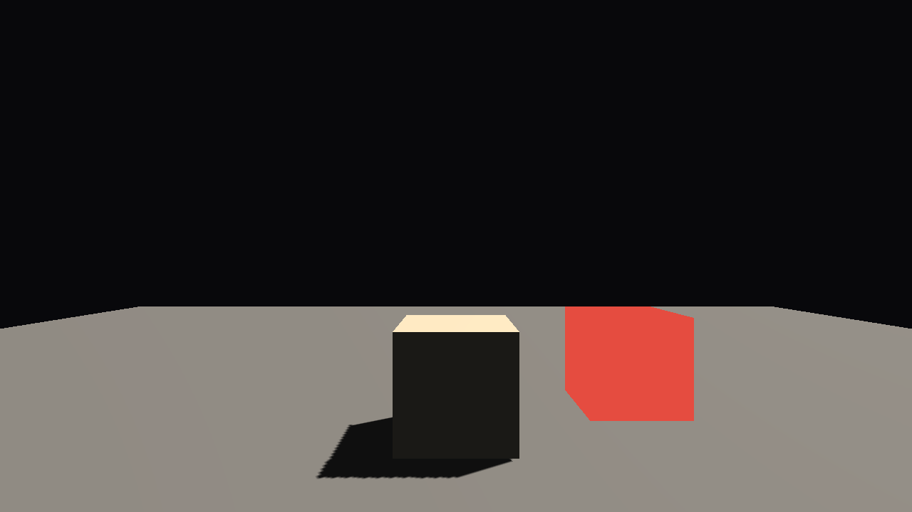
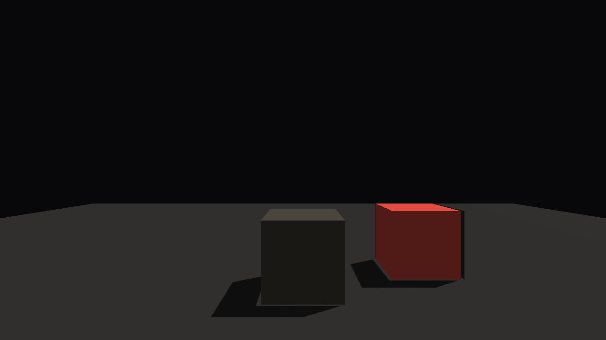

# TASK-B-R5-04 对等闸门报告：URP vs ZRender 同基准场景对比

> 生成：施工代理（general-purpose 施工子代理）｜ 2026-10-25
> 判定方式：自动指标 + **用户人工过目**（方案 §12 决策点 6——本报告不下"谁更好"结论）。
> 基准场景契约：两侧实现注释严格同文（`Native/tests/zrhi_d3d12_window.cpp` 的
> `--parity` 段 ↔ `UnityProject/Assets/Game/Editor/ParityBench.cs` 文件头），元素：
> 1280×720；相机 pos(0,1.6,-4) 朝 +Z 看 fov 60；地面 20×20 @y=0 灰 (0.5,0.5,0.5)
> smoothness 0.1；Cube A (0,0.5,0) 暖白 (0.9,0.85,0.75) smoothness 0.5；Cube B
> (1.8,0.5,0.8) 卡通红 (0.9,0.3,0.25)；方向光行进方向 (-0.5,-1,-0.3) 色 (1,0.96,0.9)
> 强度 1.2；阴影开；后处理关；固定一帧。

## 一、双截图（人工过目用）

| 管线 | 截图 | 说明 |
|---|---|---|
| URP（URP_Medium，批处理渲染） |  | `Docs/Parity/parity_urp.png`（PNG） |
| ZRender（D3D12 离屏） |  | `Docs/Parity/parity_zrender.bmp`（24bit BMP） |

目检要点（验收清单第 3 条）：地面 / 两 Cube / 阴影三元素在两图中均应可见；
构图一致（相机同参数）。

## 二、指标并排表

| 指标 | URP | ZRender | 口径说明 |
|---|---|---|---|
| 分辨率 | 1280×720 | 1280×720 | 两侧一致（契约） |
| 平均帧耗 | 1.788 ms（20 帧均值；min 1.163 / max 4.651，见 `metrics_urp.txt`） | 9.245 ms（30 帧排除首帧均值；min 8.544 / max 10.285，见 `metrics_zrender.txt`） | **口径不同，不可直接互比**：URP = Stopwatch 包 `camera.Render()` 单调用 CPU 墙钟（批处理编辑器路径，20 帧均值）；ZRender = CPU 墙钟覆盖单帧 record+submit+WaitIdle+FlushRetired（离屏无 vsync，30 帧排除首帧均值）。两侧均为 CPU 侧计时，非 GPU 纯渲染耗时；详见各自 metrics 文件 |
| DrawCall / 帧 | N/A（批处理下 ProfilerRecorder 取值为 0——人工步骤：编辑器打开同场景（契约参数见 ParityBench.cs 头），Window > Analysis > Profiler 的 Render 行 "Draw Calls Count" 或 Game 视图 Stats 面板 DrawCalls 读取） | 16（`DrawIndexedInstanced` 调用计数：阴影 4 级联×3 casters=12 + 主 pass 2 + toon 1 + outline 1） | URP 侧自动获取不可靠（简报允许的回退路径）；两侧 DrawCall 组成不同（URP 单一 forward pass + 阴影，ZRender 主/Toon/Outline 多 pass 结构），数值本身不构成优劣判断 |
| 阴影 | CSM（URP 资产参数，见 metrics_urp.txt 的 urp_asset 行） | CSM 4 级联 2048² PCF 3×3 | 阴影实现细节不同（见差异清单） |
| 后处理 | 关（`renderPostProcessing=false`，无 Volume） | 无后处理链 | 两侧一致 |

原始指标文件：`Docs/Parity/metrics_urp.txt`、`Docs/Parity/metrics_zrender.txt`。

## 三、已知预期差异清单（交人工过目，不下结论）

1. **Tonemap**：ZRender PBR 通道内置 Reinhard tonemap（`pbr_shadow.hlsl` 末段，
   `acc/(1+acc)`）；URP 侧后处理关闭 → 无 tonemap（线性直出经 sRGB 转换）。
   同一材质的亮度/高光 rolloff 因此不同。
2. **材质模型细节**：ZRender = 自写 GGX NDF + Smith（Schlick-GGX 近似）+ Lambert +
   Fresnel（`pbr_shadow.hlsl` ShadePbr）；URP Lit = Unity URP 内置 BRDF（细节近似但
   常数/可见性项实现不同）。同为"PBR"但高光形状、能量守恒处理有差异。
3. **卡通材质**：ZRender = 量化 ramp（N·L 三阶 hard band）+ 阈值高光 + 反向壳描边
   （toon 物体受风格化光）；URP 侧按简报用**无光照 Unlit 纯色 (0.9,0.3,0.25)，
   描边省略**——URP 的 Cube B 无明暗带、无描边，为简报指定的近似（非缺陷）。
4. **环境光默认**：本任务两侧刻意对齐——ZRender 常数环境项 0.12 ↔ URP
   RenderSettings Flat ambient 0.12。若未来任一侧改默认（如 URP Skybox ambient），
   背光面亮度会分化。
5. **背景清屏色**：两侧同值 (0.03,0.03,0.045)（URP Solid Color ↔ ZRender 清屏常数）。
6. **阴影细节**：URP = 资产 shadowDistance/级联数（Medium 档，见 metrics）+ 硬件
   PCF（Soft）；ZRender = 4 级联 2048² + 手写 PCF 3×3 + 深度域 bias。边缘软硬、
   泄漏特性不同。
7. **色调空间**：Unity 工程为 Linear 色彩空间（sRGB 写入由管线处理）；ZRender
   离屏目标为 RGBA8Unorm（非线性写入，BMP 按字节直出）。截图整体明暗观感可能有
   gamma 差异——属预期，非渲染错误。
8. **地面网格**：URP Plane 为 200 面片网格（scale 2 后 20×20）；ZRender 为单 quad
   （2 三角形）。DrawCall 均为 1，但顶点量不同。
9. **Cube B 阴影**：两侧均投影（ZRender 侧本任务实现 toon 物体入级联阴影图）。

## 四、结论

（留空——待用户人工过目两截图后由主控记录；本报告仅呈现事实与差异清单。）
